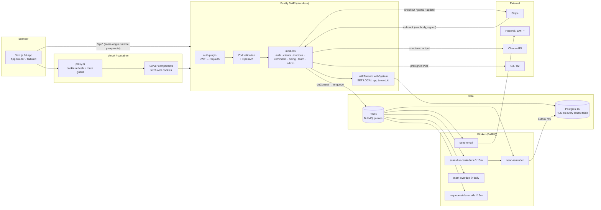

# Architecture

## Request lifecycle (authenticated write)

1. Browser calls `POST /api/v1/invoices` (same origin). The Next.js proxy route forwards it to the API, cookies included.
2. `authPlugin` verifies the `dn_access` JWT → `req.auth = { userId, tenantId, role }`.
3. Zod validates the body (coercion, defaults) and the same schema documents the endpoint in OpenAPI.
4. Handler opens `withTenant(tenantId)`: `BEGIN; SET LOCAL app.tenant_id = …`. Every query in the
   transaction is filtered by RLS.
5. Plan limit check (`assertWithinLimit`) inside the same transaction; a `PlanLimitError` rolls back and
   returns `402 PLAN_LIMIT_REACHED`, which the web app turns into an upgrade modal.
6. Audit row written in the same transaction. Emails are written to `email_log` (outbox) and the queue
   job is added in an `onCommit` hook.
7. `COMMIT` → hooks run → BullMQ job → worker → email provider → `email_log.status = sent`.

## Storage per access pattern

| Data | Store | Why |
|---|---|---|
| Tenants, users, invoices, reminders, audit | Postgres | Relational, transactional, RLS |
| Job queue, schedulers, per-job dedupe | Redis (BullMQ) | Delayed jobs, retries with backoff, locks |
| Tenant logos | S3 / R2 via presigned PUT | Bytes never transit the API |
| Stripe subscription state | Postgres cache of Stripe (webhooks are the writer) | One source of truth |

## Money
Integers only. `*_cents BIGINT`, tax in basis points, `numeric(12,2)` quantities. Rounding happens once per line.

## Failure modes considered
- Worker dies mid-reminder → conditional-UPDATE claim + BullMQ retry; the `sending` state is recoverable (runbook).
- API dies after COMMIT but before enqueue → `requeue-stale-emails` sweeper.
- Stripe replays / reorders → dedupe table + `last_event_at`.
- Redis wiped → schedulers re-registered on worker boot (`upsertJobScheduler`); pending reminders are in Postgres, not Redis.
- Postgres down → `/ready` returns 503, load balancer stops routing; jobs fail and retry.
